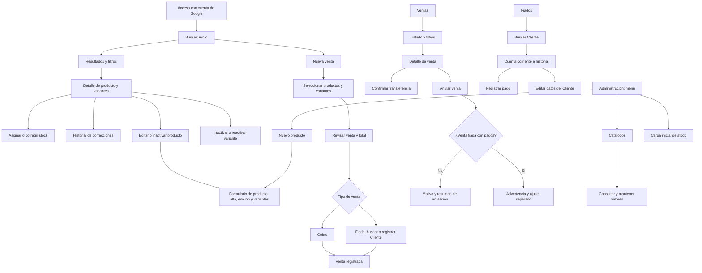

# Diseño de interfaz de usuario

Este documento organiza las pantallas y la navegación del MVP antes de elaborar
los wireframes. Las pantallas agrupan uno o más casos de uso cuando comparten
una misma tarea; por eso, la cantidad de pantallas no coincide necesariamente
con la cantidad de CU.

Los wireframes se guardarán en `diagramas/wireframes/`. Las fichas detalladas de
cada interfaz se completarán después de validar este inventario y el mapa.

## 1. Objetivo de diseño

La tarea crítica es que Silvia pueda responder una consulta de disponibilidad
mientras conversa con una clienta, usando el celular. El buscador será la
pantalla de inicio y deberá mostrar con claridad producto, variante, cantidad y
precio, con pocos pasos entre iniciar la consulta y obtener la respuesta.

## 2. Criterios globales de interfaz

- Priorizar el uso desde celular y mantener una adaptación responsive para
  otros tamaños.
- Usar una navegación principal inferior con cuatro destinos: **Buscar**,
  **Ventas**, **Fiados** y **Administración**.
- Mantener la administración de catálogos separada de las tareas cotidianas,
  según RNF-04.
- Mostrar el estado del stock con texto además de cualquier señal de color
  (por ejemplo, "Agotado" o "Quedan 2").
- Usar controles táctiles amplios, de aproximadamente 44–48 px, y ubicar las
  acciones frecuentes al alcance del pulgar.
- Evitar listas desplegables extensas. Considerar chips o paneles inferiores
  para filtros y autocompletado para productos y clientes.
- Usar un control de cantidad con incremento/decremento y teclado numérico
  cuando corresponda.
- Separar los datos generales del producto de la lista de variantes y
  considerar una generación rápida de combinaciones de talles y colores.
- Mostrar el código interno como dato de solo lectura y permitir marcar un
  atributo como "No aplica", lo que pasa el producto a una variante única, de
  acuerdo con RF-CAT-03, RN16 y DEC-010.
- En correcciones de stock, pagos y anulaciones, mostrar un resumen antes de
  confirmar. Las advertencias deben explicar el efecto de la acción.
- Al guardar, mostrar un indicador de carga y desactivar temporalmente la
  confirmación para evitar envíos duplicados; luego informar el resultado.
- Usar textos de error que expliquen el problema y la acción disponible.
- Mantener el término **Cliente** en las etiquetas visibles de la interfaz para
  las personas asociadas a ventas fiadas.
- Mantener interacciones sencillas de implementar en una aplicación web
  responsive con Google Apps Script: formularios, listas, paneles y diálogos.

## 3. Mapa de navegación

La pantalla de búsqueda es el inicio. La navegación principal da acceso a
Buscar, Ventas, Fiados y Administración. Desde los resultados se accede al
detalle del producto y a las acciones de stock; desde el detalle de una venta
se inician las acciones permitidas por su estado.

El sistema no tiene pantalla de inicio de sesión propia (DEC-006, RNF-08): el
acceso lo resuelve la autenticación de Google, que en el celular de Silvia ya
tiene la sesión abierta, por lo que se entra directo a Buscar. El nodo de acceso
del mapa representa ese paso previo. El rechazo de una cuenta no autorizada es un
estado transversal.

## 4. Inventario de pantallas y flujos

| ID | Pantalla o flujo | HU asociadas | CU cubiertos | Alcance inicial |
|----|------------------|--------------|--------------|-----------------|
| UI-01 | Buscar: inicio, filtros y resultados | HU-05, HU-06 | CU-05, CU-06 | Pantalla inicial; filtros y orden de stock bajo reutilizan el buscador. |
| UI-02 | Detalle de producto y variantes | HU-03, HU-04, HU-18, HU-19, HU-20 | CU-03, CU-04, CU-18, CU-19, CU-20 | Acceso desde resultados; muestra cantidades y acciones disponibles, incluida la inactivación de variantes. |
| UI-03 | Alta y edición de producto | HU-01, HU-03, HU-18 | CU-01, CU-03, CU-18 | Datos generales y variantes en secciones diferenciadas; también agrega variantes a un producto existente. |
| UI-04 | Carga inicial de stock | HU-02 | CU-02 | Selección de archivo, validación, resumen de errores y confirmación. |
| UI-05 | Asignación o corrección de stock | HU-03, HU-04 | CU-03, CU-04 | Flujo compartido; solo la corrección pide motivo y compara antes/después. |
| UI-06 | Historial de correcciones | HU-19 | CU-19 | Consulta ordenada, filtrable y de solo lectura. |
| UI-07 | Administración de catálogos | HU-16, HU-17 | CU-16, CU-17 | Selección de catálogo y mantenimiento de valores en una sección administrativa. |
| UI-08 | Nueva venta | HU-07, HU-09 | CU-07, CU-09 | Flujo compartido que termina en cobro o en asociación a un Cliente. |
| UI-09 | Listado y detalle de ventas | HU-15 | CU-15 | Filtros, estado, detalle y acceso a acciones disponibles. |
| UI-10 | Confirmar transferencia o anular venta | HU-08, HU-13, HU-14 | CU-08, CU-13, CU-14 | Acciones desde el detalle; CU-14 muestra una advertencia específica. |
| UI-11 | Cuenta corriente del Cliente | HU-10 | CU-10 | Búsqueda, saldo e historial de ventas fiadas y pagos. |
| UI-12 | Datos del Cliente | HU-11 | CU-11 | Edición accesible desde la cuenta corriente. |
| UI-13 | Registrar pago | HU-12 | CU-12 | Formulario desde la cuenta corriente y resumen antes de confirmar. |
| UI-14 | Administración: menú | — | — | Menú de tres entradas: Nuevo producto (UI-03), Catálogos (UI-07) y Carga inicial de stock (UI-04). No resuelve ningún CU por sí misma; solo da acceso. Los productos existentes se editan desde UI-01 y UI-02. |

Las pantallas de carga, acceso no autorizado, estado vacío, ausencia de resultados, error de
conexión, confirmación y éxito son estados transversales; no se consideran
pantallas independientes salvo que el wireframe muestre que requieren un flujo
propio. La decisión final se documentará en las fichas detalladas.

## 5. Estados transversales

Para cada pantalla se evaluarán, cuando correspondan, estos estados:

- Cargando o guardando.
- Acceso no autorizado, cuando la cuenta de Google no es la de la propietaria.
- Vacío, cuando todavía no hay información cargada.
- Sin resultados para los filtros seleccionados.
- Error de conexión con opción de reintentar.
- Éxito después de una consulta o una operación.
- Confirmación previa a operaciones que modifican datos o no pueden deshacerse.

## 6. Consideraciones de accesibilidad

- Los estados "Agotado", "Quedan 2", "Pendiente" y "Anulada" deben comunicarse
  mediante texto y no depender solo del color.
- Los botones y controles frecuentes deben tener un área táctil amplia para el
  uso desde el celular.
- Los campos de texto deben usar un tamaño legible (al menos 16 px en móvil) y
  las acciones solo con icono deben tener un nombre accesible.
- Los errores deben explicar qué dato corregir o qué acción tomar.

## 7. Fichas detalladas de interfaz

Cada ficha vincula la pantalla con las HU y CU que resuelve, describe sus
interacciones y justifica las decisiones con el contexto real de uso.

### UI-01 — Buscar: inicio, filtros y resultados

**Historias de Usuario asociadas:** HU-05, HU-06

**Casos de uso asociados:** CU-05, CU-06

**Wireframe:** Pendiente; guardar en `diagramas/wireframes/01-buscar-stock.png`.

**Navegación:** Viene de la navegación inferior (Buscar); va al detalle de producto (UI-02).

**Objetivo de la pantalla:** Permitir que Silvia encuentre rápidamente un
producto y vea las variantes y cantidades disponibles, tanto al responder una
consulta como al revisar qué reponer.

**Patrones de diseño propuestos:**

- Campo de búsqueda visible al inicio para nombre, código interno o marca.
- Panel inferior de filtros que se abre sobre la lista, con filtros seleccionados
  visibles como chips.
- Resultados agrupados por producto, cada tarjeta muestra nombre, marca, temporada, precio y las variantes que coinciden con los criterios, cada una con su cantidad. Todas las variantes del producto, incluidas las agotadas, las sin cantidad asignada y las inactivas, se ven en el detalle (UI-02).
- Navegación inferior fija: Buscar, Ventas, Fiados y Administración.

**Justificación:** El relevamiento identifica la consulta de disponibilidad
desde el celular como la necesidad central; Silvia suele responder consultas
recibidas por WhatsApp o Instagram y hoy debe revisar físicamente la mercadería.
El campo de búsqueda visible reduce el inicio del recorrido. El panel de filtros
permite combinar criterios opcionales (RF-BUS-04 a RF-BUS-06) sin abandonar los
resultados. Agrupar las variantes bajo el producto mantiene el contexto de la
prenda, mientras que mostrar cantidad y precio responde a RF-BUS-12 y RF-BUS-13.
La misma pantalla permite ordenar por cantidad y filtrar agotados para apoyar la
reposición (CU-06, RF-BUS-08 y RF-BUS-14).

**Acciones principales e interacción:**

- Buscar por nombre con coincidencias parciales o por código interno o por marca.
- Abrir filtros y combinar categoría, grupo, género, talle, color, temporada y
  disponibilidad; los criterios no seleccionados no restringen la búsqueda.
- Aplicar los filtros seleccionados conjuntamente y volver a los resultados.
- Ordenar la lista por cantidad disponible de menor a mayor.
- Incluir productos y variantes inactivos mediante una opción explícita; por
  defecto quedan ocultos.
- Abrir el detalle del producto (UI-02) al tocar un resultado.
- Quitar un filtro tocando su chip, o limpiar todos los filtros.
- Cambiar entre las secciones principales mediante la navegación inferior.

**Formulario y criterios:**

- Campos: texto de búsqueda; filtros de categoría, grupo, género, talle, color,
  temporada y disponibilidad; opción para incluir inactivos.
- Flujo: búsqueda y resultados en la misma pantalla; filtros en un panel que se
  puede abrir y cerrar sin perder el contexto de la lista.
- Validaciones: exigir al menos un criterio, entendiendo como criterio cualquier filtro, incluidos "Disponibles" y "Agotados" (no "Todos"); combinar los criterios activos; informar cuando no hay coincidencias.
- El filtro de stock bajo no define un umbral: se resuelve mediante el orden
  ascendente para que Silvia evalúe visualmente las cantidades.

**Estados a representar:**

- Inicio sin búsqueda aplicada.
- Cargando resultados.
- Resultados encontrados.
- Sin resultados para los criterios seleccionados.
- Resultados con productos o variantes inactivos, identificados con la palabra
  "Inactivo" o "Inactiva".
- Catálogo todavía vacío.
- Error de conexión con posibilidad de reintentar.

**Prueba de recorrido para el wireframe:** Simular la consulta “body nena,
talle 2, rosa” y contar los toques desde que Silvia abre la aplicación hasta que
puede leer la cantidad de la variante. El objetivo es reducir pasos innecesarios;
el wireframe permitirá evaluar el recorrido antes de fijar un límite concreto.

**Accesibilidad:** La disponibilidad debe aparecer como texto (“Agotado”,
“Quedan 2”), no solo como color. Los controles de filtro deben poder identificarse
por nombre y operarse cómodamente desde el celular.

### UI-02 — Detalle de producto y variantes

**Historias de Usuario asociadas:** HU-03, HU-04, HU-05, HU-18, HU-19, HU-20

**Casos de uso asociados:** CU-03, CU-04, CU-18, CU-19, CU-20 (CU-05 como origen)

**Wireframe:** Pendiente; guardar como `diagramas/wireframes/02-detalle-producto.png`.

**Navegación:** Viene de UI-01 (al tocar un resultado) y de UI-03 (tras guardar un
producto). Va a UI-03 (editar producto, agregar variante), UI-05 (asignar o
corregir stock) y UI-06 (historial de una variante).

**Objetivo de la pantalla:** Mostrar un producto con todos sus datos y todas sus
variantes, y ser el punto de partida de las acciones de gestión sobre el producto
y sobre cada variante.

**Patrones de diseño propuestos:**

- Encabezado compacto con los datos clave del producto.
- Lista de variantes ordenada por talle, con cantidad y estado visibles en cada fila.
- Menú de acciones por variante en un panel inferior.
- Acciones del producto agrupadas en la parte superior.
- Confirmación para inactivar un producto o una variante, con advertencia si hay
  stock.
- Aviso visible cuando el producto está inactivo.
- Las variantes inactivas siguen en la lista, identificadas con la palabra
  "Inactiva" y sin acciones de stock.

**Justificación:** Silvia necesita ver todas las variantes de un producto,
incluidas las agotadas y las sin cantidad, y actuar sobre una puntual sin perder de
vista cuál es. UI-01 muestra solo lo que coincide con la búsqueda; esta pantalla es
la única con el panorama completo. Un menú por variante evita repetir botones en
cada fila y mantiene la lista legible en el celular. Ordenar por talle y mostrar el
género respeta cómo ella reconoce una prenda (relevamiento, sección 6.1). Separar la
consulta (UI-01 y UI-02) de la edición (UI-03) y de los formularios de stock (UI-05)
evita pantallas sobrecargadas.

**Acciones principales e interacción:**

- Volver a UI-01 conservando filtros y posición de la lista.
- Editar producto: abre UI-03 (CU-18).
- Inactivar o reactivar: pide confirmación y advierte si hay stock (CU-18, RF-CAT-24).
- Agregar variante: abre UI-03 en la sección de variantes (CU-03).
- Por variante activa: "Asignar stock" (solo si no tiene cantidad), "Corregir
  stock" (CU-04), "Ver historial" (CU-19) e "Inactivar variante" (CU-20). Las
  primeras abren UI-05 y UI-06; la inactivación pide confirmación y advierte si la
  variante tiene stock o es la única activa (RF-CAT-26).
- Por variante inactiva: "Reactivar variante" y "Ver historial".
- Si el producto está inactivo, las variantes no ofrecen inactivar ni reactivar
  (CU-20, E3).

**Información que se muestra:**

- Producto: código interno (solo lectura), nombre, marca, categoría, grupo,
  temporada, precio vigente y estado.
- Variante: talle, género, color, estampado (si aplica), cantidad y estado, con los
  mismos textos que UI-01: "Quedan N", "Agotado", "Sin cantidad asignada" e
  "Inactiva".

**Formulario y criterios:**

- La pantalla no tiene formularios propios; están en UI-03 y UI-05.
- Código interno y categoría se muestran solo como lectura.
- Una variante sin cantidad asignada ofrece "Asignar stock" y no "Corregir stock".
- Una variante inactiva conserva su cantidad visible, pero no admite asignar ni
  corregir stock hasta reactivarla (RF-STK-21).

**Estados a representar:**

- Cargando.
- Producto activo con variantes con stock, agotadas y sin cantidad asignada.
- Producto inactivo, con aviso visible.
- Confirmación de inactivación de producto con advertencia de stock.
- Variante inactiva, identificada con la palabra "Inactiva".
- Confirmación de inactivación de variante, con advertencia si tiene stock o es la
  única activa.
- Error de conexión con posibilidad de reintentar.

**Prueba de recorrido para el wireframe:** Desde un resultado de UI-01, llegar a
corregir la cantidad de una variante puntual (body nena, talle 2, rosa) y contar los
toques hasta abrir el formulario de UI-05.

**Accesibilidad:** El estado de cada variante se indica con texto y no solo con
color. Filas y menú con zonas táctiles cómodas. Las acciones de inactivar (producto o
variante) se diferencian de las demás y piden confirmación para evitar tocarlas por
error. Ninguna acción
depende de gestos como mantener presionado.

### UI-03 — Alta y edición de producto

**Historias de Usuario asociadas:** HU-01, HU-03, HU-18

**Casos de uso asociados:** CU-01 (registrar), CU-03 (agregar variante), CU-18
(modificar datos)

**Wireframe:** Pendiente; guardar como `diagramas/wireframes/03-alta-edicion-producto.png`.

**Navegación:** Viene de Administración (UI-14, "Nuevo producto") y de UI-02
("Editar producto" y "Agregar variante"). Al guardar va a UI-02 con un aviso de
éxito; al cancelar vuelve a la pantalla de origen. Desde UI-02 se ofrece asignar
stock (UI-05).

**Objetivo de la pantalla:** Permitir que Silvia registre un producto con sus
variantes, corrija sus datos generales o agregue variantes que faltan, con un
mismo formulario y pocos toques.

**Modos de la pantalla:** Un solo formulario con tres modos, para no duplicar
pantallas.

| Modo | Se abre desde | Qué se puede hacer |
|------|---------------|--------------------|
| Alta | UI-14, "Nuevo producto" | Completar los datos generales y definir las variantes (CU-01). |
| Edición | UI-02, "Editar producto" | Modificar nombre, marca, grupo, temporada y precio (CU-18). |
| Agregar variante | UI-02, "Agregar variante" | Abre la sección de variantes, con las existentes en solo lectura, para sumar combinaciones nuevas (CU-03). |

La inactivación y la reactivación del producto (CU-18) y de sus variantes (CU-20)
se hacen en UI-02, donde ya está la confirmación con advertencia; esta pantalla solo
crea y edita datos.

**Patrones de diseño propuestos:**

- Dos secciones diferenciadas en una misma pantalla con desplazamiento vertical:
  "Datos del producto" y "Variantes".
- Campos con etiqueta siempre visible, no solo texto de ayuda dentro del campo.
- Selección sin listas desplegables extensas: chips para los catálogos con pocos
  valores (temporada, género, grupo) y panel inferior para los más numerosos
  (categoría, color, estampado, talle).
- Generador de variantes: se eligen talles, colores y géneros, y el sistema propone
  todas las combinaciones, que se pueden quitar una a una antes de guardar.
- Barra inferior fija con "Guardar" y "Cancelar", al alcance del pulgar.
- Código interno visible como dato de solo lectura.

**Justificación:** El relevamiento (sección 7) indica que parte de la compra a
proveedores es "por curva": un mismo diseño en toda la escala de talles. Cargar cada
combinación a mano multiplica los toques, por eso el generador. El alta es esporádica
(CU-01) y la carga inicial masiva se hace por planilla (CU-02), de modo que esta
pantalla se optimiza para claridad y para evitar errores antes que para velocidad
extrema. Separar datos generales y variantes responde al criterio global de la
sección 2 y a que precio, temporada y marca son del producto y comunes a todas sus
variantes (RN13, RN15). Un solo formulario para alta, edición y agregado de variantes
mantiene acotado el inventario de pantallas y reutiliza las validaciones.

**Acciones principales e interacción:**

- Completar nombre y precio vigente; elegir la categoría y la temporada; opcionalmente
  completar la marca y elegir un grupo.
- Elegir talles, colores y géneros y, de forma opcional, un estampado; tocar "Generar
  variantes", revisar la lista y quitar las combinaciones que no existan.
- Marcar talle, género o color como "No aplica" cuando el producto no lo requiera.
- Agregar un valor de catálogo que falta (por ejemplo, un color nuevo) desde el
  propio selector, con la opción "Agregar valor" al final de la lista.
- Guardar: valida, informa el resultado y lleva a UI-02.
- Cancelar: si hay datos ingresados sin guardar, pide confirmación antes de
  descartarlos.
- En edición, ver el resumen de cambios (valor anterior y nuevo) antes de
  confirmar.

**Variante única ("No aplica"):** Cuando Silvia marca talle, género o color como
"No aplica", el producto se registra con una única variante (RN16, DEC-010).
El generador se reemplaza por la elección de un solo valor para cada atributo que sí
aplica. Si hace falta distinguir colores en un producto sin talle o sin género, se
registran productos distintos (por ejemplo, "Vincha rosa" y "Vincha celeste"). Un
producto con variante única activa no ofrece "Agregar variante"; si la variante se
cargó por error, se inactiva en UI-02 (CU-20) y se agrega la correcta.

**Generación rápida de variantes:**

- Los talles se ofrecen en el orden definido por la propietaria (RN43), no
  alfabético, y solo se ofrecen valores activos de catálogo (RF-CAT-21).
- Talles, colores y géneros admiten selección múltiple. El estampado es opcional y se
  elige uno para todo el lote, porque un mismo diseño lleva el mismo estampado en
  todos los talles; otro estampado se carga como otro lote.
- Antes de agregar, se informa cuántas variantes se generarán.
- Una combinación repetida dentro del producto no se agrega y se informa (CU-01 E3,
  RN18). En "Agregar variante" se omiten las combinaciones que ya existen, activas o
  inactivas, y se informa cuántas; si la existente está inactiva, se ofrece
  reactivarla (RF-CAT-28, RN47).
- Las variantes generadas quedan sin cantidad; la cantidad se asigna después en UI-05
  (CU-03), sin pedir motivo.

**Alta rápida de valores de catálogo:** El selector de cada catálogo termina con
"Agregar valor", que abre un panel con el nombre (y la posición, si es un talle). Se
aplican las validaciones de CU-16: nombre obligatorio, único en su catálogo sin
distinguir mayúsculas y, si coincide con un valor desactivado, se ofrece reactivarlo.
El valor queda seleccionado al volver al formulario. El mantenimiento de los
catálogos (renombrar, ordenar, desactivar y reactivar) sigue en UI-07, según RNF-04.

**Información que se muestra:**

- Producto: código interno (solo lectura; en el alta, "Se genera al guardar"),
  nombre, marca, categoría, grupo, temporada, precio vigente y estado.
- Variante en la lista: talle, color, género y estampado. En las ya existentes,
  también cantidad y estado, con los mismos textos que UI-01 y UI-02.

**Formulario y criterios:**

- Campos obligatorios: nombre, categoría, precio y al menos una variante (CU-01 E1
  y E4). Opcionales: marca, grupo y estampado.
- Precio: teclado numérico; debe ser un número mayor a cero (RN48, CU-01 E2,
  CU-18 E1).
- Marca: texto libre; mientras se escribe se sugieren las marcas ya usadas para
  evitar variantes de escritura que dispersen las búsquedas.
- En edición, el código interno y la categoría son solo lectura; si la categoría se
  cargó por error, se inactiva el producto y se registra otro (CU-18 E5).
- Cambiar la temporada la aplica a todas las variantes y la pantalla lo aclara
  (RF-STK-09). Cambiar el precio solo afecta a las ventas posteriores (RN14, RN45) y
  el resumen lo dice.
- Un valor de catálogo desactivado no se ofrece para elegir, pero si el producto ya
  lo tiene se muestra como valor actual con la marca "desactivado" y se puede guardar
  sin cambiarlo (RF-CAT-21).
- Si no se modificó ningún dato, informa que no hay cambios y no guarda (CU-18 E2).
- En un producto inactivo se pueden editar los datos, pero la sección de variantes
  queda en solo lectura, porque agregar variantes exige un producto activo
  (precondición de CU-03).
- Los errores se muestran junto al campo y explican qué corregir.

**Estados a representar:**

- Alta con formulario vacío y edición con datos cargados.
- Errores de validación por campo, variante repetida y falta de variantes.
- Producto con variante única, sin la opción "Agregar variante".
- Catálogo sin valores (por ejemplo, ninguna categoría cargada), con el aviso de que
  puede agregarse el primer valor desde el selector.
- Panel "Agregar valor" abierto, con sus errores.
- Guardando, con la confirmación desactivada para evitar envíos duplicados.
- Resumen de cambios antes de confirmar la edición.
- Confirmación al salir con datos sin guardar.
- Éxito, que lleva a UI-02 con el aviso y, en el alta, el código generado y la
  opción de asignar stock.
- Error de conexión: no se guarda nada parcial, se conservan los datos ingresados y
  se permite reintentar (CU-01 E6, CU-18 E7).
- Producto inactivo, con aviso visible y variantes en solo lectura.

**Prueba de recorrido para el wireframe:** Registrar el producto "Body manga larga",
categoría Body, grupo bebé nena, temporada invierno, con los talles 1 a 5 en rosa y
género nena, y contar los toques desde "Nuevo producto" hasta ver el producto
guardado. Repetir cargando las cinco variantes de a una para medir cuánto ahorra el
generador. Segunda prueba: registrar una vincha rosa sin talle ni género (variante
única). Tercera prueba: cambiar el precio de un producto existente y contar los
toques hasta confirmar.

**Accesibilidad:** Cada campo tiene etiqueta visible y un tamaño de texto de al menos
16 px. Los chips seleccionados se distinguen con un símbolo o texto, no solo con
color, y exponen su estado a lectores de pantalla. Los controles tienen zonas
táctiles cómodas y la barra fija no tapa el campo activo. Los errores nombran el
campo y la acción.

### Fichas pendientes

Continuar con UI-04 (Carga inicial de stock), y luego avanzar por el resto del
inventario de la sección 4. La pantalla UI-14 (menú de Administración) no tiene
ficha propia por ahora: solo da acceso a UI-03, UI-04 y UI-07.