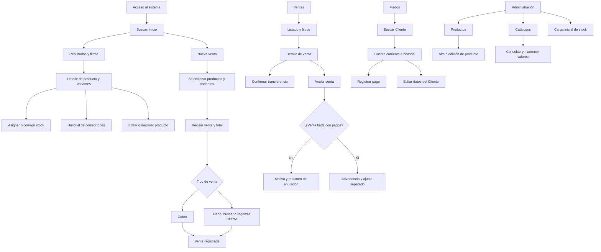

# Diseño de interfaz de usuario

Este documento organiza las pantallas y la navegación del MVP antes de elaborar
los wireframes. Las pantallas agrupan uno o más casos de uso cuando comparten
una misma tarea; por eso, la cantidad de pantallas no coincide necesariamente
con la cantidad de CU.

Los wireframes se guardarán en `diagramas/wireframes/`. Las fichas detalladas de
cada interfaz se completarán después de validar este inventario y el mapa.

## 1. Objetivo de diseño

La tarea crítica es que Silvia pueda responder una consulta de disponibilidad
mientras conversa con una clienta, usando el celular. El buscador será la
pantalla de inicio y deberá mostrar con claridad producto, variante, cantidad y
precio, con pocos pasos entre iniciar la consulta y obtener la respuesta.

## 2. Criterios globales de interfaz

- Priorizar el uso desde celular y mantener una adaptación responsive para
  otros tamaños.
- Usar una navegación principal inferior con cuatro destinos: **Buscar**,
  **Ventas**, **Fiados** y **Administración**.
- Mantener la administración de catálogos separada de las tareas cotidianas,
  según RNF-04.
- Mostrar el estado del stock con texto además de cualquier señal de color
  (por ejemplo, "Agotado" o "Quedan 2").
- Usar controles táctiles amplios, de aproximadamente 44–48 px, y ubicar las
  acciones frecuentes al alcance del pulgar.
- Evitar listas desplegables extensas. Considerar chips o paneles inferiores
  para filtros y autocompletado para productos y clientes.
- Usar un control de cantidad con incremento/decremento y teclado numérico
  cuando corresponda.
- Separar los datos generales del producto de la lista de variantes y
  considerar una generación rápida de combinaciones de talles y colores.
- Mostrar el código interno como dato de solo lectura y utilizar "No aplica"
  automáticamente cuando corresponda, de acuerdo con RF-CAT-03 y RN16.
- En correcciones de stock, pagos y anulaciones, mostrar un resumen antes de
  confirmar. Las advertencias deben explicar el efecto de la acción.
- Al guardar, mostrar un indicador de carga y desactivar temporalmente la
  confirmación para evitar envíos duplicados; luego informar el resultado.
- Usar textos de error que expliquen el problema y la acción disponible.
- Mantener el término **Cliente** en las etiquetas visibles de la interfaz para
  las personas asociadas a ventas fiadas.
- Mantener interacciones sencillas de implementar en una aplicación web
  responsive con Google Apps Script: formularios, listas, paneles y diálogos.

## 3. Mapa de navegación

La pantalla de búsqueda es el inicio. La navegación principal da acceso a
Buscar, Ventas, Fiados y Administración. Desde los resultados se accede al
detalle del producto y a las acciones de stock; desde el detalle de una venta
se inician las acciones permitidas por su estado.

El acceso se representa como punto de entrada, pero la necesidad de una pantalla
de inicio de sesión propia queda pendiente de definir según el mecanismo de
autenticación de la alternativa Google Sheets + Google Apps Script.

## 4. Inventario de pantallas y flujos

| ID | Pantalla o flujo | HU asociadas | CU cubiertos | Alcance inicial |
|----|------------------|--------------|--------------|-----------------|
| UI-01 | Buscar: inicio, filtros y resultados | HU-05, HU-06 | CU-05, CU-06 | Pantalla inicial; filtros y orden de stock bajo reutilizan el buscador. |
| UI-02 | Detalle de producto y variantes | HU-03, HU-04, HU-18, HU-19 | CU-03, CU-04, CU-18, CU-19 | Acceso desde resultados; muestra cantidades y acciones disponibles. |
| UI-03 | Alta y edición de producto | HU-01, HU-18 | CU-01, CU-18 | Datos generales y variantes en secciones diferenciadas. |
| UI-04 | Carga inicial de stock | HU-02 | CU-02 | Selección de archivo, validación, resumen de errores y confirmación. |
| UI-05 | Asignación o corrección de stock | HU-03, HU-04 | CU-03, CU-04 | Flujo compartido; solo la corrección pide motivo y compara antes/después. |
| UI-06 | Historial de correcciones | HU-19 | CU-19 | Consulta ordenada, filtrable y de solo lectura. |
| UI-07 | Administración de catálogos | HU-16, HU-17 | CU-16, CU-17 | Selección de catálogo y mantenimiento de valores en una sección administrativa. |
| UI-08 | Nueva venta | HU-07, HU-09 | CU-07, CU-09 | Flujo compartido que termina en cobro o en asociación a un Cliente. |
| UI-09 | Listado y detalle de ventas | HU-15 | CU-15 | Filtros, estado, detalle y acceso a acciones disponibles. |
| UI-10 | Confirmar transferencia o anular venta | HU-08, HU-13, HU-14 | CU-08, CU-13, CU-14 | Acciones desde el detalle; CU-14 muestra una advertencia específica. |
| UI-11 | Cuenta corriente del Cliente | HU-10 | CU-10 | Búsqueda, saldo e historial de ventas fiadas y pagos. |
| UI-12 | Datos del Cliente | HU-11 | CU-11 | Edición accesible desde la cuenta corriente. |
| UI-13 | Registrar pago | HU-12 | CU-12 | Formulario desde la cuenta corriente y resumen antes de confirmar. |

Las pantallas de acceso, carga, estado vacío, ausencia de resultados, error de
conexión, confirmación y éxito son estados transversales; no se consideran
pantallas independientes salvo que el wireframe muestre que requieren un flujo
propio. La decisión final se documentará en las fichas detalladas.

## 5. Estados transversales

Para cada pantalla se evaluarán, cuando correspondan, estos estados:

- Cargando o guardando.
- Vacío, cuando todavía no hay información cargada.
- Sin resultados para los filtros seleccionados.
- Error de conexión con opción de reintentar.
- Éxito después de una consulta o una operación.
- Confirmación previa a operaciones que modifican datos o no pueden deshacerse.

## 6. Consideraciones de accesibilidad

- Los estados "Agotado", "Quedan 2", "Pendiente" y "Anulada" deben comunicarse
  mediante texto y no depender solo del color.
- Los botones y controles frecuentes deben tener un área táctil amplia para el
  uso desde el celular.
- Los campos de texto deben usar un tamaño legible (al menos 16 px en móvil) y
  las acciones solo con icono deben tener un nombre accesible.
- Los errores deben explicar qué dato corregir o qué acción tomar.

## 7. Fichas detalladas de interfaz

Cada ficha vincula la pantalla con las HU y CU que resuelve, describe sus
interacciones y justifica las decisiones con el contexto real de uso.

### UI-01 — Buscar: inicio, filtros y resultados

**Historias de Usuario asociadas:** HU-05, HU-06

**Casos de uso asociados:** CU-05, CU-06

**Wireframe:** Pendiente; guardar en `diagramas/wireframes/`.

**Objetivo de la pantalla:** Permitir que Silvia encuentre rápidamente un
producto y vea las variantes y cantidades disponibles, tanto al responder una
consulta como al revisar qué reponer.

**Patrones de diseño propuestos:**

- Campo de búsqueda visible al inicio para nombre o código.
- Panel inferior de filtros que se abre sobre la lista, con filtros seleccionados
  visibles como chips.
- Resultados agrupados por producto, con variantes y cantidad disponible
  claramente identificadas.
- Navegación inferior fija: Buscar, Ventas, Fiados y Administración.

**Justificación:** El relevamiento identifica la consulta de disponibilidad
desde el celular como la necesidad central; Silvia suele responder consultas
recibidas por WhatsApp o Instagram y hoy debe revisar físicamente la mercadería.
El campo de búsqueda visible reduce el inicio del recorrido. El panel de filtros
permite combinar criterios opcionales (RF-BUS-04 a RF-BUS-06) sin abandonar los
resultados. Agrupar las variantes bajo el producto mantiene el contexto de la
prenda, mientras que mostrar cantidad y precio responde a RF-BUS-12 y RF-BUS-13.
La misma pantalla permite ordenar por cantidad y filtrar agotados para apoyar la
reposición (CU-06, RF-BUS-08 y RF-BUS-14).

**Acciones principales e interacción:**

- Buscar por nombre con coincidencias parciales o por código interno.
- Abrir filtros y combinar categoría, grupo, género, talle, color, temporada y
  disponibilidad; los criterios no seleccionados no restringen la búsqueda.
- Aplicar los filtros seleccionados conjuntamente y volver a los resultados.
- Ordenar la lista por cantidad disponible de menor a mayor.
- Incluir productos inactivos mediante una opción explícita; por defecto quedan
  ocultos.
- Abrir el detalle del producto y sus variantes al seleccionar un resultado.
- Cambiar entre las secciones principales mediante la navegación inferior.

**Formulario y criterios:**

- Campos: texto de búsqueda; filtros de categoría, grupo, género, talle, color,
  temporada y disponibilidad; opción para incluir inactivos.
- Flujo: búsqueda y resultados en la misma pantalla; filtros en un panel que se
  puede abrir y cerrar sin perder el contexto de la lista.
- Validaciones: exigir al menos un criterio; combinar los criterios activos;
  informar cuando no hay coincidencias.
- El filtro de stock bajo no define un umbral: se resuelve mediante el orden
  ascendente para que Silvia evalúe visualmente las cantidades.

**Estados a representar:**

- Inicio sin búsqueda aplicada.
- Cargando resultados.
- Resultados encontrados.
- Sin resultados para los criterios seleccionados.
- Catálogo todavía vacío.
- Error de conexión con posibilidad de reintentar.

**Prueba de recorrido para el wireframe:** Simular la consulta “body nena,
talle 2, rosa” y contar los toques desde que Silvia abre la aplicación hasta que
puede leer la cantidad de la variante. El objetivo es reducir pasos innecesarios;
el wireframe permitirá evaluar el recorrido antes de fijar un límite concreto.

**Accesibilidad:** La disponibilidad debe aparecer como texto (“Agotado”,
“Quedan 2”), no solo como color. Los controles de filtro deben poder identificarse
por nombre y operarse cómodamente desde el celular.

### Fichas pendientes

Continuar con UI-02 (Detalle de producto y variantes) y UI-03 (Alta y edición de
producto), y luego avanzar por el resto del inventario de la sección 4.